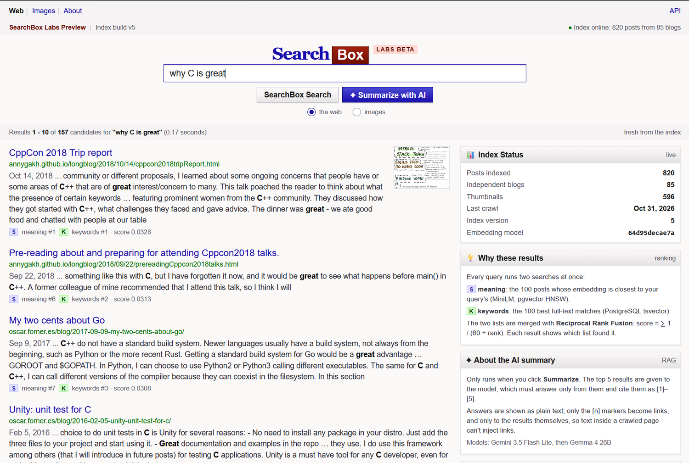
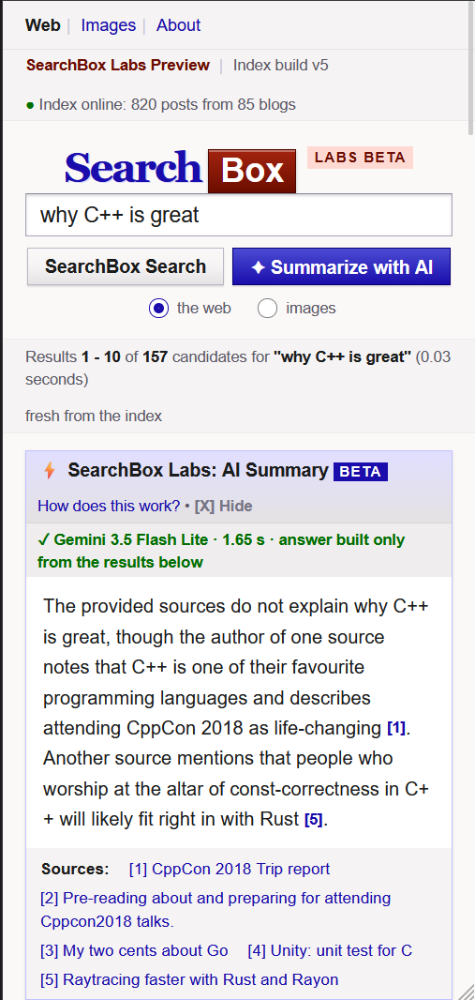
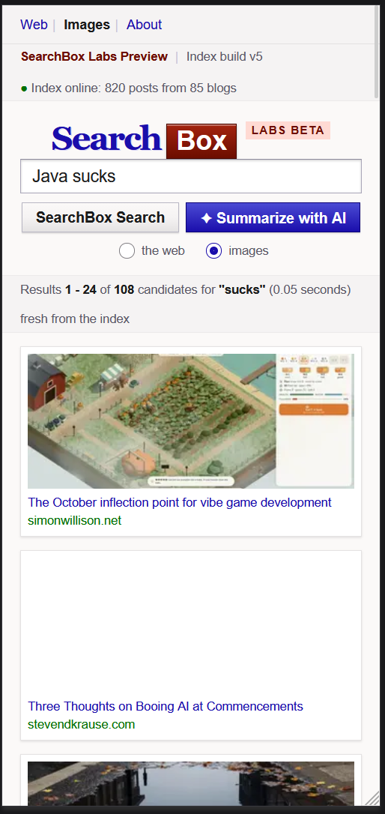
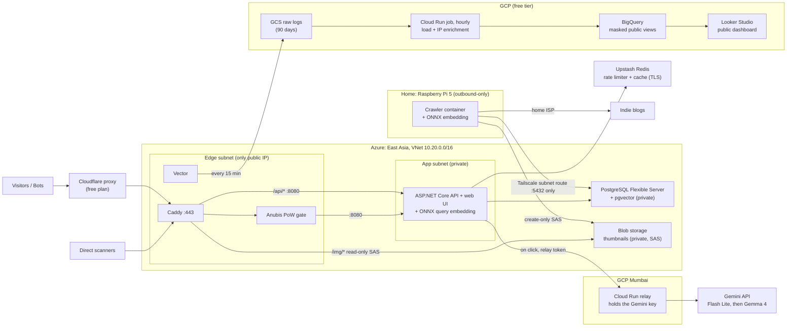

# Searchbox: Anti-SEO Semantic Search + Live Bot-Telemetry SIEM

A small search engine for the independent web. It indexes personal and indie blogs only, ranks them with **hybrid semantic + keyword search**, filters out SEO spam with an explicit, explainable **quality gate**, shows **image results** and an optional **AI summary** of the top results with citations. Every request that hits the site, human or bot, flows into a **security analytics pipeline** with a public live dashboard.

The edge works as a **honeypot-style sensor**: a proof-of-work gate challenges browsers, exploit probes (`/.env`, `/wp-login.php`, ...) are denied and logged, and every request is analyzed in BigQuery.

This is a portfolio project.

## Screenshots

<p align="center">
  
</p>
<p align="center"><em>Hybrid search. Each result shows which ranking found it, by meaning (S) and by keywords (K), and its Reciprocal Rank Fusion score. The index status panel is live data.</em></p>

<table>
  <tr>
    <td align="center" width="50%">
      <br>
      <em>AI summary on mobile. It answers only from the top five results, cites them as [n], and says so when they don't answer the question.</em>
    </td>
    <td align="center" width="50%">
      <br>
      <em>Image search. One sanitised WebP thumbnail per post, served from private Blob storage through the edge.</em>
    </td>
  </tr>
</table>

---

## Architecture



| Tier | Where | Role |
|---|---|---|
| **Edge** | Azure VM `B2ats_v2` | Caddy (TLS with a Cloudflare Origin CA cert), Anubis proof-of-work gate, Vector log shipper, `/img/*` proxy to Blob storage, fallback page. The only public IP in the system. |
| **App** | Azure VM `B2pts_v2` (Arm64), private | ASP.NET Core API + retro web UI; embeds queries in-process with ONNX Runtime. |
| **Data** | Azure, private | PostgreSQL 17 + pgvector (HNSW, `halfvec`); Blob storage for thumbnails. |
| **Cache / limits** | Upstash Redis (free tier, TLS) | Leaky-bucket rate limiter and result cache; everything fails open if it's down. |
| **AI** | Gemini API, through a Cloud Run relay in Mumbai | Optional summary of the top 5 results, with a model fallback chain. The relay exists because Gemini refuses requests from Hong Kong (Azure East Asia); it also keeps the Gemini key off the app VM. |
| **Crawler** | Raspberry Pi 5 at home | Feed crawl (run by hand; a weekly systemd timer is included), text extraction, quality gate, thumbnails, embedding. Makes outbound connections only. |
| **SIEM** | GCP | GCS → hourly Cloud Run job (loads new log files into BigQuery, enriches new IPs with IPinfo and AbuseIPDB) → masked views → Looker Studio dashboard, embedded at `/security.html`. |

### How a search works
1. Cloudflare → Caddy → app VM over the private VNet (the browser UI passes the Anubis challenge first; `/api/*` goes around it for app clients).
2. A **leaky-bucket rate limiter** (an atomic Lua script in Redis) checks the client IP: bursts of 10, sustained 20 searches/min.
3. The **cache admits a query only on its second sighting** (an in-memory Bloom filter), so one-off queries never touch Redis.
4. The API embeds the query with **all-MiniLM-L6-v2** (int8 ONNX, 384 dimensions), using the exact model file the crawler used (checked by SHA-256 at startup).
5. Postgres runs two rankings, nearest embeddings (HNSW) and full-text (`tsvector`), and fuses them with **Reciprocal Rank Fusion**. Each result shows which ranking found it.
6. **AI summary (on click):** the top 5 results go, through the relay, to Gemini Flash Lite, falling back to Gemma 4, under global per-model limits. The answer is plain text, and only its `[n]` citations become links, to the results themselves.

### How the index is built
On each crawl, the Pi:
1. reads the allowlisted domains;
2. fetches each RSS/Atom feed with a conditional GET;
3. extracts clean text from new posts with trafilatura, keeping English posts of 300+ words;
4. runs the **quality gate** (ad/affiliate scripts, listicle titles, LLM boilerplate, posting bursts) and logs the reasons;
5. makes **one thumbnail per post** (re-encoded to WebP) and uploads it with a create-only token;
6. embeds each post and upserts it;
7. bumps `index_version`.

---

## Security model

Designed so that **nothing on the internet can open a connection into the home network**.

- **One public IP.** The edge VM accepts only 80/443 and has no public SSH. Admin access is through Tailscale SSH, with the Azure serial console as break-glass.
- **Network segmentation with NSGs.** Edge → app on 8080 only, app → Postgres on 5432 only. The edge has an explicit outbound deny to the rest of the VNet, so a compromised edge can't reach the data tier.
- **Private data tier.** Postgres has no public endpoint and requires TLS. The API connects with a **read-only** database role. Redis (Upstash) is TLS-only and password-protected, and holds only rate-limit counters and public search results.
- **Least-privilege storage tokens.** The crawler can only *create* thumbnails; Caddy can only *read* them, and only paths matching `<hash>.webp`. The container is never public.
- **Outbound-only home node.** A Tailscale ACL (with policy tests) lets the crawler reach Postgres:5432 and nothing else, and lets nothing reach the crawler. The home router has no forwarded ports.
- **A crawler that can't be turned against the LAN.**
  - Every request, including each redirect hop, is refused if it points at a non-public address: home ranges, loopback, link-local, Tailscale, cloud metadata.
  - Images are hostile input: SVG is rejected, size and pixel limits stop decompression bombs, and everything is re-encoded to WebP (which also strips EXIF/GPS metadata).
  - The crawler runs in a read-only, non-root container with all capabilities dropped and resource limits.
- **Safe rendering.**
  - The UI inserts crawled text only as text, never HTML, and a strict Content-Security-Policy blocks inline scripts.
  - AI answers can't create links: only `[n]` citations become links, to known result URLs.
  - Client IPs are trusted only from the edge VM, and the edge trusts Cloudflare's header only from Cloudflare's ranges.
- **AI relay.** Gemini calls go through a Cloud Run relay that accepts only a shared token, only `generateContent` for two allowlisted models, and only small JSON bodies. The real key lives in Secret Manager; a leaked token can't reveal it.
- **Model integrity.** The embedding model is pinned by SHA-256. The crawler and the API refuse to run with a different file, and a Python↔C# parity test confirms they produce identical vectors.
- **A privacy-aware SIEM.** Search terms (query strings) never leave the edge. The public views mask IPs (IPv4 /24, IPv6 /48) and exclude the owner's networks, and they are the dashboard's only source. Vector's GCS key can only create objects in one bucket; `Cf-Ipcountry` is trusted only on requests that really came through Cloudflare.

---

## Tech stack

| Area | Tools |
|---|---|
| Infrastructure as code | Terraform (azurerm 4.x), remote state in Azure Storage, developed in GitHub Codespaces |
| Cloud | Azure (VMs, VNet/NSGs, PostgreSQL Flexible Server, Blob Storage), GCP (Cloud Run, Secret Manager, GCS, BigQuery, Looker Studio), Cloudflare, Upstash |
| Networking | Tailscale (tagged nodes, subnet router, ACL with tests), Caddy, Anubis |
| API | C# / ASP.NET Core 10 (minimal APIs), Npgsql, StackExchange.Redis, xUnit |
| Search | PostgreSQL 17, pgvector 0.8 (HNSW, `halfvec`), full-text search, Reciprocal Rank Fusion |
| ML | all-MiniLM-L6-v2, ONNX Runtime (Python and .NET), int8 dynamic quantization, Hugging Face `tokenizers` / `Microsoft.ML.Tokenizers`, Gemini 3.5 Flash Lite / Gemma 4 26B for summaries |
| Crawler | Python, httpx, feedparser, trafilatura, Pillow, psycopg 3, Docker, systemd timers |
| Web UI | Plain HTML/CSS/JS, retro 2007 styling |
| Observability | Vector, BigQuery, UptimeRobot, Healthchecks.io |

---

## Repository layout

```
infra/azure/        Terraform: network + NSGs, app VM, Postgres, thumbnail storage, edge VM (Caddy)
api/                ASP.NET Core API + web UI, tests, deploy scripts
relay/              Cloud Run relay for Gemini (stdlib Python) + tests
infra/gcp/          Terraform: relay, SIEM (log bucket, BigQuery dataset + views, service accounts, scheduler)
siem/               Hourly SIEM job (load + enrich) + tests, dashboard spec
crawler/            Feed crawler, quality gate, thumbnails, embedder, search CLI, Docker + systemd
db/                 Database schema and roles
```

Setup: [`crawler/README.md`](crawler/README.md), [`api/README.md`](api/README.md), [`relay/README.md`](relay/README.md) and [`siem/README.md`](siem/README.md).

---

## Cost

Built on the Azure for Students credit and free tiers:
- **Free:** both VMs, Postgres B1ms with 32 GB, both OS disks, Blob storage (5 GB), Upstash Redis, the Gemini API, GCP (the Cloud Run relay, Secret Manager, and the logging pipeline) and Cloudflare.
- **Paid from credit:** the edge VM's public IP, about **$3.60/month**.

Everything on Azure is in one resource group managed by Terraform, so tearing it down or rebuilding it is one command each.

---

## AI Usage

The architecture was planned and coded with AI assistance, code was written by AI under my direction. I reviewed, deployed and operate it.
